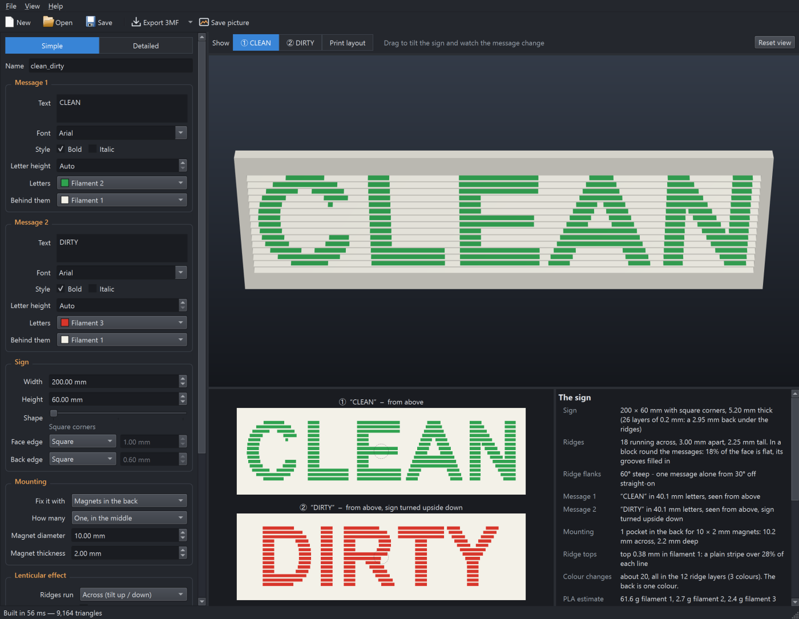
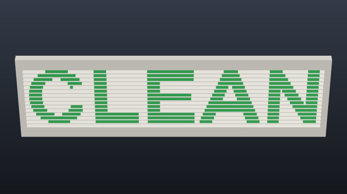
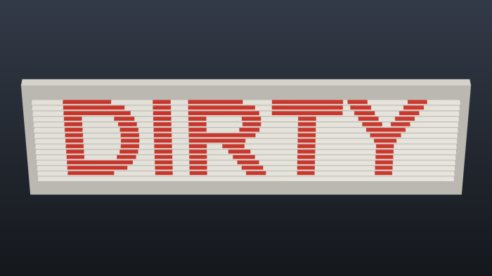
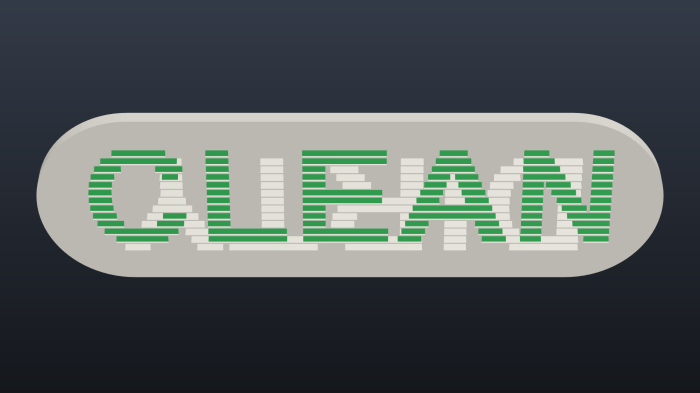
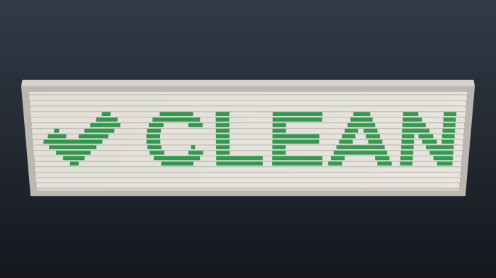
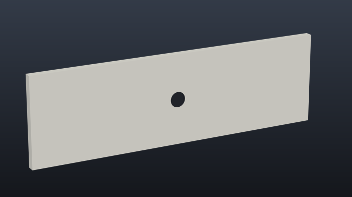
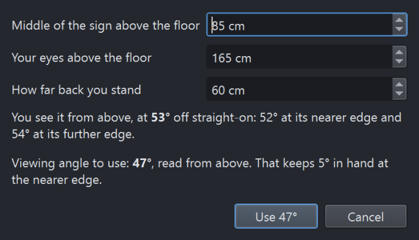
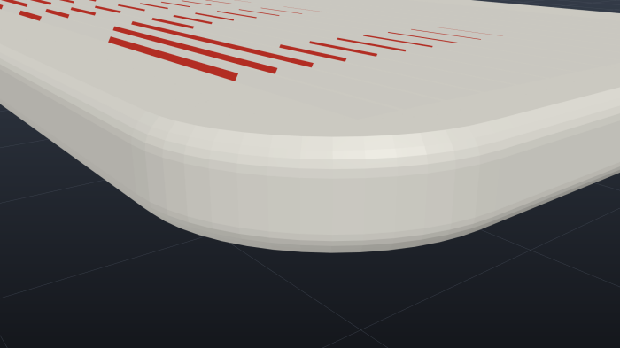
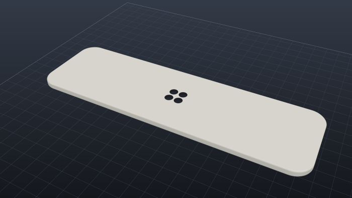

# Lenticular Sign Maker

A Windows desktop app that designs **3D-printable lenticular signs**: signs that show one message from
one side and a different message from the other, printed in several colours.

The classic use is a dishwasher sign that reads **CLEAN**, and **DIRTY** once you turn it upside down.
The face of the sign is a row of small ridges. One flank of every ridge carries the first message and
the other flank the second, so from one side of straight-on you see only the first set of flanks.

The app lays out both messages, shows the sign in 3D from each side, and exports a multi-colour 3MF
(one part per filament) that is ready to slice.



| Read from above: CLEAN | Turned upside down: DIRTY |
|---|---|
|  |  |
| **Round ends, ridges only where needed** | **A circle** |
|  |  |
| **Pictures beside the words** | **Changes as you walk past: OPEN / CLOSED** |
|  |  |
| **One magnet in the back, to spin it on** | **Working out the viewing angle** |
|  |  |
| **Chamfillet edges: nothing over 45°** | **Printed face down, on four small magnets** |
|  |  |

## Features

* Two messages, each with its own **text, font, letter height, spacing, direction and position**, and
  optionally a **picture** (any image file or SVG) beside the words or instead of them.
* **Turn over to change** (the sign is turned upside down to swap messages) or **look from either
  side** (the message changes between above and below, or left and right, as you walk past).
* Ridges **across** the sign (tilt up / down) or **up and down** it (tilt left / right).
* **Shape slider:** square corners, rounded corners, semicircular ends, and on to a full circle. The
  ridges, frame and letters follow the outline.
* **Chamfered, rounded or chamfillet edges** round the face and round the back, each with its own
  size. A chamfillet is a rounding made printable: nothing on it overhangs more than 45°.
* **Up to four filaments**, assigned freely: coloured letters on a white ground, white letters on two
  coloured grounds, a dark back, and so on.
* **Ridges cover** the whole face, a block round the messages, or only where they are needed, with
  the rest of the face filled in flat.
* **Mounting:** pockets in the back for disc magnets (one in the middle to spin the sign on, four
  smaller ones together in the middle to spin it on, two, or four in the corners), or eyelets on the
  edge to hang it by.
* **Print face up or face down:** face down, the exported file is already turned over, so the frame
  and ridge tops take the finish of the bed.
* A **viewing-angle helper** works out the angle you really see the sign from, from where it hangs and
  where you stand, and sets the ridges to suit.
* Built for real printers: no colour is made narrower than a printed line, the sign is a whole
  number of layers thick, and the top of every ridge is one plain colour, so the slicer has nothing
  too thin to drop.
* Exports a **3MF** with each filament as its own part (Flash Studio / OrcaSlicer read the filament
  numbers), or **one STL per filament**.

## Download and run

* **Windows app (no Python needed):** download `LenticularSignMaker.exe` from the
  [Releases](../../releases) page and run it. It is a single file: nothing to unzip or install.
  The app isn't code-signed, so Windows SmartScreen may say "Windows protected your PC": click
  **More info → Run anyway**.
* **From source (any OS with Python 3.10+):**

  ```
  pip install -r requirements.txt
  python main.py
  ```

  On Windows, `run.bat` sets up a virtual environment in `.venv` the first time and starts the app.
* **Build the exe yourself:** run `build_exe.bat`. It writes `dist\LenticularSignMaker.exe`.

`examples\` holds designs to open: the dishwasher sign with square and with round ends, a spinning
one on four small magnets with chamfillet edges, a tick and a cross from picture files, an OPEN / CLOSED sign that changes as you walk past, a tall FREE / BUSY sign
with stacked letters, and a round IN / OUT sign.

## Using it

Type the two messages, pick fonts and filaments, and watch the 3D view. The buttons over the view
show the sign as each message is read; switching between them swings or turns the sign. Drag the
view to tilt the sign and watch one message give way to the other. **Print layout** shows it as it
prints: flat on its back on the bed, or face down.

The two flat pictures underneath show exactly what each message is reduced to, one strip per ridge,
and the panel on the right gives the sizes, colour changes and filament used, with any warnings.

**Simple** shows the essentials; **Detailed** shows every setting.

### Each message

| Setting | What it does |
| --- | --- |
| **Text, Font, Style, Letter height** | The words. Auto letter height makes the message as big as fits; with both messages on Auto they get the same height. |
| **Picture** | An image file or SVG drawing beside the text (left, right, above or below), or instead of it. It is reduced to two tones: a picture with see-through parts counts wherever it is solid, one without wherever it is dark. **Swap its tones** uses the other parts. |
| **Text runs** | Across, letters stacked one under another, or turned a quarter turn. |
| **Letter spacing, Move** | Spread the letters out or close them up, and move the message off centre. |
| **Letters, Behind them** | Which filament this message's letters and its ground use. |

### The sign

| Setting | What it does |
| --- | --- |
| **Width, Height, Shape** | The size, and the shape slider: square corners at the left, semicircular ends in the middle, a circle at the right. Past the middle the shorter side grows to match the longer one. |
| **Frame, Margin, Back thickness** | The flat rim round the ridges, the clear space round the messages, and the solid back. |
| **Face edge, Back edge** | Each outer edge square, chamfered (cut off at 45°), rounded, or a *chamfillet*, and how far in and down it reaches. A chamfillet is round where it meets the side and turns into a 45° chamfer where the curve would get flatter than that, so it never overhangs more than 45° on the bed; its size is the radius, and it reaches 0.59 × that far in. The face edge is cut from the frame, so it stays narrower than the frame; the back edge stays within the back's thickness and clear of any magnet pockets. A chamfer or chamfillet on the bed side also stops the first layer squashing out into a lip. |
| **Fix it with** | *Magnets in the back*: round pockets, open underneath, to glue disc magnets into – one in the middle (the sign spins on it), four side by side in a square round the middle (it still spins, for when you only have smaller magnets), two at the ends or four in the corners. The back is thickened if the magnets need it. *Eyelets*: flat rings on the edge, as thick as the back. |
| **Ridges run** | *Across*: the message changes between looking from above and from below. *Up and down*: between the left and the right. |
| **Turn over to change** | On: always read from the same side, and turn the sign upside down to change the message. Off: the sign stays put and each side sees its own message. |
| **Read from** | The side message 1 is read from: above for a sign below eye level, below for one high up. |
| **Ridges cover** | *The whole face*, or only part of it, with the grooves of the rest filled in so the face is flat there. *A block round the messages* keeps one block of ridges holding both messages. *Only where needed* keeps them only under the letters; the other message's letters then show as ridged patches in the plain colour. |
| **Viewing angle** | How far off straight-on you must be to see one message alone (30° by default). **Work out…** finds it from the height of the sign, your eye height and how far back you stand. |
| **Ridge pitch, Ridge crest** | Spacing of the ridges – the size of one picture line, about 3 mm for a 0.4 mm nozzle – and the flat on top of each. |
| **Filaments, Back and frame, Ridge tops** | Four colours, and which of them the back and the tops of the ridges use. Only the filaments something uses are exported. |
| **Print face down** | Off: the sign prints flat on its back, ridges up. On: it is exported turned over, face down with the back on top. The frame and ridge tops take the bed's finish, magnet pockets open upwards, and eyelets are made as thick as the whole sign so they rest on the bed. |
| **Layer height, Line width** | What you slice with. The sign is a whole number of layers thick and no colour is narrower than a line. |

## Printing

* Print with no supports, flat on its back with the ridges up – or face down, if you chose that.
  Magnet pockets bridge over on their own face up, and are open at the top face down.
* The colours only meet in the ridges, so all the filament changes are in those layers – about 20
  for the dishwasher example. The back is one colour.
* Face down, the first layer is the frame and the thin ridge tops, so a clean, level bed matters.
  The ridges print without supports while their flanks are 45° or steeper (a viewing angle of 45°
  or less).
* On the bed side, a chamfillet or a chamfer prints more cleanly than a plain rounded edge, whose
  lowest part overhangs.
* Slice at the layer height the sign was built for (shown in the side panel).
* Use 100% infill, or four or more top and bottom layers, so the back prints solid.
* Glue the magnets in afterwards.

## Opening the 3MF in your slicer

**Export 3MF** writes the sign as one object with a part for each filament, lying flat in the middle
of the bed (face down, if you chose that).

* In **Flash Studio or OrcaSlicer**, use **File → Import** (Ctrl+I). The parts arrive already set to
  their filament numbers, so load those colours in those slots. Opening the file as a project instead
  shows "loading geometry data only": that is harmless, and your printer and filament settings stay
  as they are.
* In other slicers, give each part its filament yourself, or use **Export STLs** and load the files
  together as one object with several parts.

## Project layout

| File | What it holds |
| --- | --- |
| `main.py` | Starts the app. |
| `lenticular/app.py` | The main window: settings panel, views, exports and the viewing-angle helper. |
| `lenticular/geometry.py` | The sign itself: outline, ridges, frame, filled grooves, magnet pockets and eyelets, as one mesh per filament. |
| `lenticular/textimage.py` | Text and pictures turned into masks. |
| `lenticular/preview.py` | The flat pictures of each message. |
| `lenticular/viewer.py` | The OpenGL 3D view. |
| `lenticular/viewing.py` | The viewing-angle sums. |
| `lenticular/params.py` | Settings, and saving and opening designs. |
| `lenticular/threemf.py`, `stl.py` | The exports. |
| `tests/test_sign.py` | Self-tests. |

### How the geometry works

Each message is drawn as a mask of the sign's face. Every ridge is one line of both pictures: its
flank shows letter colour along the stretches where the mask, averaged over the ridge's width, is
mostly letter. The sign is built from closed prisms sorted by filament – the back, the frame, and
every stretch of every ridge flank – that meet face to face; where the outline curves, ridge ends are
cut into narrow strips that follow it. The top of each ridge, down to where each flank is a full
printed line wide, is a separate plain strip. A chamfered, rounded or chamfillet edge makes the side
of the sign a stack of outlines, each moved in by the right amount for its height, joined by flat
facets.

`.venv\Scripts\python -m tests.test_sign` checks that every mesh is closed and has the volume it
should, draws the finished mesh from each viewing side to confirm the right message shows, and checks
that magnet pockets, eyelet holes, filled grooves and chamfered or rounded edges are where they
should be, and that a sign turned over to print face down is turned, not mirrored.

## License

MIT – see [LICENSE](LICENSE).
